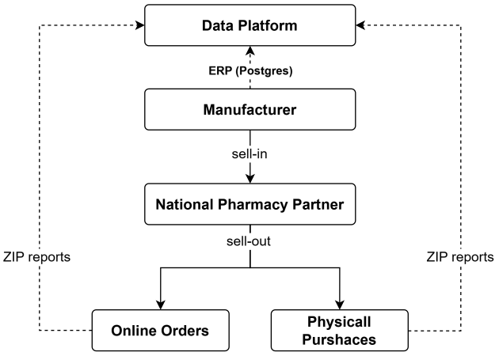
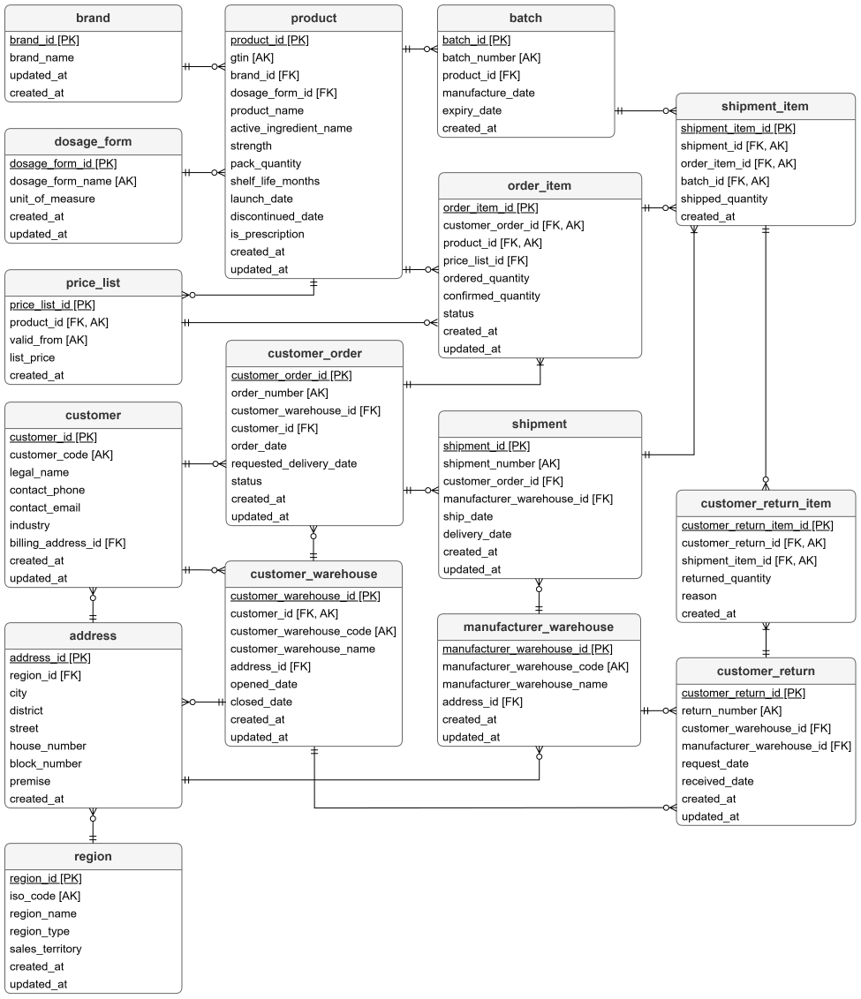
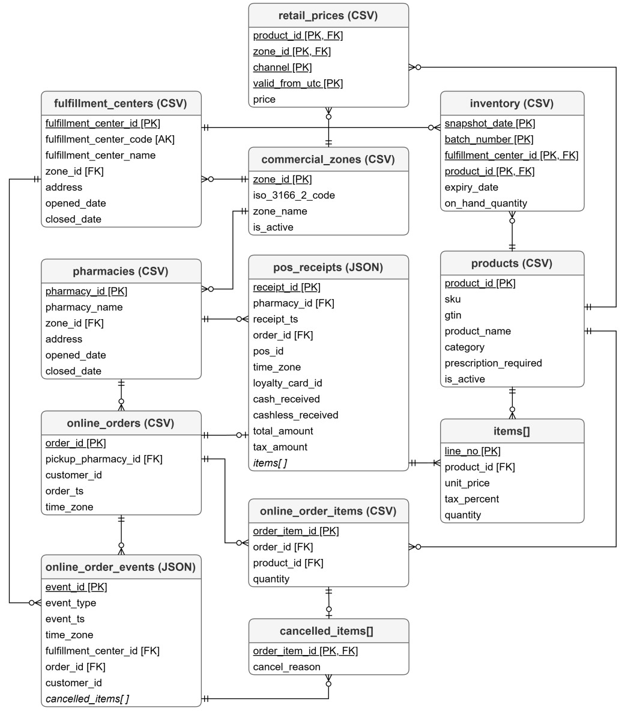

# **Business Case**
- [**Business Case**](#business-case)
  - [**Overview**](#overview)
  - [**ERP system**](#erp-system)
  - [**National Pharmacy**](#national-pharmacy)

## **Overview**

<p>Imagine that we work in the headquarters of a mid-size pharmaceutical manufacturer of drugs. We never sell the products to patients ourselves. Our drugs reach them through our main partner, a national pharmacy chain that buys about 60% of our volume. The partner receives our shipments at fulfillment centers and sells to patients through two channels:</p>

- **Pharmacies.** About 400 pharmacies across the country, where patients come in and buy drugs.
- **Online orders.** Patients order drugs on the partner's website, a fulfillment center sends the order to the pharmacy, where the patient picks it up.

<p>Data is collected at several points in this chain, and only one of them belongs to us. Our ERP system records every shipment that leaves our warehouses. This is called sell-in, and it tells us what the partner bought.</p>

<p align="center">
  
</p>

<p>The most useful data is collected by the partner: it records every sale to a patient, and counts its stock every day. We have no access to the partner's systems, so the partner has signed a data service agreement. It obliges the partner to upload its daily sales, inventory and master data to its own S3 bucket as ZIP archives daily. We pay the partner a monthly fee only if every delivery is on time, complete and in the agreed format.</p>

<p>Our ERP shows what the partner bought from us, not what patients need. Management has many goals that our own data cannot answer, some of them:</p>

- **Plan production from real demand.** We raise our price list once a year in January, and the partner buys ahead at the old price: a 6% increase can make it order two months of stock in December, after which our shipments fall almost to zero while patients keep buying as before. Only the partner's sales to patients show real demand, including online orders it cancelled because a drug was out of stock.
- **Keep the right amount of stock in the channel.** Too little, and the partner runs out and patients cannot buy our drugs. Too much, and packages get close to expiry and come back to us as returns. The partner's daily inventory and sales show how many days of stock it holds, which also checks its agreed cap of 21 days of sales.
- **Set the right prices for the partner.** The partner sets its own prices for patients. Its price lists and receipts show how much it earns on our drugs in each region and whether it passes our January increase on to patients.

## **ERP system**

<p>Our ERP is a PostgreSQL database in 3NF. It is a simplified sales module of the manufacturer's ERP and covers only what sell-in needs.</p>

<p align="center">
  
</p>

| Table | Description |
|---|---|
| `product` | Drugs we produce, each in one strength and pack size. Each product has its own Global Trade Item Number (GTIN) - a unique, universal product identifier. |
| `brand` | Trade names under which we sell our drugs. |
| `dosage_form` | Physical forms in which products are made, with the units their pack sizes are measured in. |
| `batch` | Batches in which products are produced. |
| `price_list` | Prices we charge partners for products, starting from given dates. When a price changes, a new row is added and the old one is kept. |
| `customer` | Partner companies that buy our products directly from us. |
| `customer_warehouse` | Partners' warehouses that receive our shipments. |
| `manufacturer_warehouse` | Our own warehouses where products are stored. |
| `address` | All addresses in the database. |
| `region` | Regions of the country with their ISO 3166-2 codes and the sales territories they belong to. Sales territories are our own groups of regions that we use in sales reports. |
| `customer_order` | Customers' requests to buy our products, delivered to their warehouses. `status` is one of `new`, `confirmed`, `partially_shipped`, `shipped` and `cancelled`. |
| `order_item` | Products in customer orders, with how many packs customers asked for, how many we confirmed, and the prices that apply. `status` is one of `pending`, `confirmed`, `shipped` and `cancelled`. |
| `shipment` | Shipments of products from our warehouses for orders. An order may need several shipments. |
| `shipment_item` | Products of one batch sent in a shipment for one order item. An order item filled from two batches has two shipment items. |
| `customer_return` | Customers' requests to send products back from their warehouses to ours. |
| `customer_return_item` | Packs returned from shipment items. `reason` is one of `expired`, `short_expiry` and `damaged`. |

## **National Pharmacy**

<p>The partner sells products from many manufacturers, but under the data service agreement it sends data only about our products. It buys all of them directly from us, so every pack in its stock came from one of our shipments.</p>
<p>The keys in the diagram are logical and agreed with the partner. The files have no constraints.</p>
<p align="center">
  
</p>

| File | Format | Description |
|---|---|---|
| `commercial_zones` | CSV | Commercial zones where the partner operates. Each zone covers exactly one region of the country. |
| `pharmacies` | CSV | The partner's pharmacies. Pharmacies have no link to fulfillment centers, because several centers can supply one pharmacy. |
| `fulfillment_centers` | CSV | The partner's fulfillment centers that receive our shipments and send drugs to pharmacies. `fulfillment_center_code` is the same as `customer_warehouse_code` in our ERP. |
| `products` | CSV | The partner's catalog of our products. |
| `retail_prices` | CSV | Prices the partner charges patients for products in each zone and channel, starting from given times. `channel` is `pharmacy` or `online`. |
| `inventory` | CSV | Stock of each batch of a product at each fulfillment center at the end of the day. |
| `online_orders` | CSV | Orders patients placed on the partner's website, with the pharmacies where they will pick them up. Orders never change after they are written. |
| `online_order_items` | CSV | Products in online orders and how many packs patients asked for. Items are written once and never change. |
| `online_order_events` | JSON | Changes in the life of online orders. `event_type` is one of `confirmed`, `items_cancelled`, `shipped_to_pharmacy`, `ready_for_pickup`, `picked_up` and `not_picked_up`. `cancelled_items` is filled only for `items_cancelled`. `event_ts` is local time. |
| `pos_receipts` | JSON | Sales in pharmacies, with the products sold and how patients paid. `order_id` is filled only for online orders. `receipt_ts` is local time. |

<p>Every day the partner uploads one ZIP archive for each file to its S3 bucket, ten archives in total. Each CSV archive holds a single file. The <code>online_order_events</code> archive holds one file for each hour of the day. The <code>pos_receipts</code> archive holds one file for each pharmacy, exported by the partner's head office from its central system.</p>

```
s3://national-pharmacy-exports/daily/
├── pharmacies/pharmacies-2026-10-09.zip
│   └── pharmacies-2026-10-09.csv
├── online_order_events/online_order_events-2026-10-09.zip
│   ├── online_order_events-2026-10-09-00.json
│   ├── ...
│   └── online_order_events-2026-10-09-23.json
├── pos_receipts/pos_receipts-2026-10-09.zip
│   ├── pos_receipts-2026-10-09-PH-0001.json
│   ├── ...
│   └── pos_receipts-2026-10-09-PH-0400.json
└── ...
```


